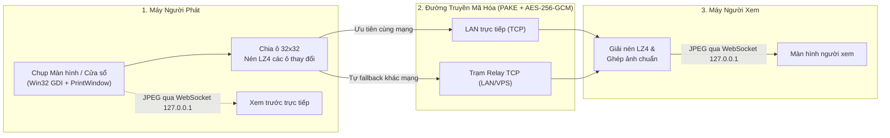

# Cẩm Nang Nhanh Dự Án CrocStream (`PROJECT_GUIDE.md`)

> **Tài liệu cốt lõi dành cho thành viên nhóm & bảo vệ đồ án (đọc trong 3–5 phút).** Nắm trọn bài toán, kiến trúc, điểm mới so với `schollz/croc` gốc và câu trả lời khi thuyết trình.

---

## A. Tổng quan trong 1 phút

### 1. Dự án giải quyết vấn đề gì?
* **Hạn chế của `schollz/croc` gốc:** `croc` là công cụ dòng lệnh (CLI) gửi file tĩnh hoặc chia sẻ shell SSH (cần biết trước kích thước file, gửi xong là đóng) và không có giao diện đồ họa truyền màn hình thời gian thực.
* **Bài toán băng thông màn hình:** Một ảnh HD (`1280×720`) dạng RGBA nặng **3,68 MB**. Gửi thô 24 FPS tốn ~88 MB/giây, trong khi màn hình làm việc (code, tài liệu, slide) phần lớn diện tích đứng yên.
* **Giải pháp của CrocStream:**
  1. Tách cơ chế mật mã và phòng chờ của `croc` thành **kênh truyền hai chiều liên tục (`crocduplex`)** có xác thực **PAKE + mã hóa đầu cuối AES-256-GCM**, hỗ trợ **tự ưu tiên LAN trực tiếp** khi cùng Wi-Fi và **tự động chuyển sang Relay** khi khác mạng.
  2. Xây dựng bộ nén **Tile-Delta** (`32×32` pixel, LZ4 không mất dữ liệu) chỉ gửi những ô có màu thay đổi, tiết kiệm **85% – 95% băng thông** khi làm việc thông thường.
  3. Cung cấp giao diện desktop Windows gọn nhẹ cho phép chọn **toàn màn hình hoặc từng cửa sổ ứng dụng** (Chrome, Zalo, VS Code, PowerPoint…) với **xem trước trực tiếp** trước khi phát.

### 2. Luồng sử dụng thực tế
1. Nếu có sẵn file `relay.json` cạnh `crocstream.exe`, cả hai máy tự điền sẵn địa chỉ & mật khẩu Relay (không cần gõ lại).
2. **Người phát** mở **Chia sẻ màn hình** → chọn tab **Màn hình** hoặc **Cửa sổ** (xem trước trực tiếp ngay trên khung 16:9) → bấm **Bắt đầu chia sẻ** → bấm **Sao chép mã** (`cs1-...`) gửi cho người xem.
3. **Người xem** mở **Tham gia bằng mã** → dán mã mời → bấm **Tham gia phiên**.
4. Hai máy tự ưu tiên nối thẳng qua **LAN trực tiếp** nếu cùng mạng, hoặc tự động đi qua **Relay** (LAN/VPS) nếu khác mạng; cả hai tuyến đều bắt tay PAKE và mã hóa AES-256-GCM đầu cuối. Khi bấm **Dừng chia sẻ**, phiên đóng sạch và mã mời lập tức bị hủy.

---

## B. Hệ thống hoạt động như thế nào?



Toàn bộ quá trình diễn ra qua **3 cơ chế chính**:
1. **Kết nối LAN-first, Fallback Relay & Mã hóa đầu cuối (`internal/crocduplex`, `internal/transport`):**
   * Khi Host tạo phiên, app vừa đăng ký phòng lên Relay vừa mở cổng TCP tạm kèm bộ phản hồi khám phá UDP LAN (`9019`, giao thức `CSL1` chỉ dùng tag băm SHA-256 16 byte tách miền — tuyệt đối không phát mã mời hay mật khẩu ra LAN).
   * Khi Viewer tham gia, app quét LAN trong ~400 ms trước; nếu thấy Host cùng mạng sẽ nối thẳng LAN, nếu không thấy (khác mạng hoặc bị tường lửa chặn) sẽ tự động rơi về Relay.
   * Cả hai tuyến đều chạy cùng một bắt tay **PAKE** (`CSH1`) và dẫn xuất khóa mã hóa **AES-256-GCM** riêng theo chiều gửi/nhận. Mục **Đường truyền** chỉ báo `LAN trực tiếp` hay `Relay` sau khi bắt tay thực sự thành công.
2. **Chụp màn hình / cửa sổ & Nén Tile-Delta (`internal/capture`, `internal/delta`):**
   * Hỗ trợ chụp toàn màn hình (`EnumDisplayMonitors` + `BitBlt`/`StretchBlt`) lẫn cửa sổ ứng dụng đơn lẻ (`EnumWindows` + `PrintWindow(PW_RENDERFULLCONTENT)` + cắt viền bóng DWM), nhận diện cả cửa sổ đang thu nhỏ dưới thanh tác vụ và tự động làm mới danh sách cửa sổ.
   * Khung đầu gửi đầy đủ (**`KEYFRAME`**). Các khung sau chia lưới `32×32` (920 ô ở `1280×720`), chỉ đóng gói **`DELTA`** các ô có độ lệch màu trung bình `MAE > tau` (mặc định `4`). Nếu quá **65%** ô thay đổi hoặc đủ chu kỳ `KeyInterval` (mặc định UI **120 khung**, tùy chỉnh `1–120`), tự gửi lại `KEYFRAME`.
3. **Tự phục hồi lỗi (`PLI`) & Hiển thị mượt (`internal/bridge`):**
   * Nếu máy xem phát hiện khung lỗi/lệch, nó giữ nguyên ảnh hợp lệ cuối, báo `Đang phục hồi ảnh` và gửi **`REQUEST_KEYFRAME` (PLI)** về máy phát.
   * Ảnh hiển thị được chuyển sang **JPEG** trong RAM và đẩy qua **WebSocket cục bộ (`127.0.0.1`)** có token ngẫu nhiên theo phiên và kiểm tra Origin.

---

## C. Sơ đồ thư mục & Bảng tra cứu nhanh trong `app/`

```text
CrocStream/
├── app/                           # [PHẦN MỀM CHÍNH]
│   ├── main_windows.go            # Điểm khởi chạy cửa sổ desktop Windows (Wails v3)
│   ├── frontend/src/              # ---> GIAO DIỆN NGƯỜI DÙNG (React + TypeScript)
│   │   ├── main.tsx               #      Màn hình trang chủ (Chia sẻ / Xem / Kiểm tra nguồn)
│   │   ├── stream.tsx             #      Màn hình Chia sẻ & Xem phiên, tự nạp relay.json
│   │   ├── local-preview.tsx      #      Màn hình Kiểm tra nguồn chụp cục bộ
│   │   ├── capture-settings.tsx   #      Bộ chọn tab Màn hình / Cửa sổ, độ phân giải & FPS
│   │   ├── stream-metrics.tsx     #      Thanh chỉ số FPS, KiB/s, RTT, Đường truyền & Chi tiết luồng
│   │   └── hooks/                 #      useSession, useFrameStream, useSourcePreview, useDisplays
│   ├── internal/                  # ---> BACKEND (Go)
│   │   ├── capture/               #      Chụp màn hình (GDI) & cửa sổ ứng dụng (PrintWindow)
│   │   ├── frame/                 #      Chuẩn hóa ảnh chụp về RGBA8888 cố định
│   │   ├── delta/                 #      Chia ô 32x32, lọc MAE (tau) và nén LZ4 lossless
│   │   ├── protocol/              #      Đóng/mở khung gói tin (Header 18 byte, CONFIG 11 byte)
│   │   ├── crocduplex/            #      Mã mời cs1-, khám phá LAN (CSL1), PAKE & AES-256-GCM
│   │   ├── transport/             #      Nạp relay.json (config.go), bật LAN-first & đo tuyến (factory.go)
│   │   ├── session/               #      Điều phối vòng đời phiên Chia sẻ / Xem & phục hồi PLI
│   │   ├── preview/               #      Điều phối xem trước cục bộ
│   │   ├── bridge/                #      WebSocket 127.0.0.1 xác thực đẩy JPEG lên WebView
│   │   ├── latest/                #      Hàng đợi chỉ giữ 1 khung mới nhất chống trễ
│   │   ├── telemetry/             #      Đo FPS, tốc độ KiB/s, baseline toàn ảnh & % tiết kiệm
│   │   └── desktop/               #      Các binding Go cho giao diện React gọi xuống
│   └── cmd/demo-relay/            # Chương trình trạm Relay cục bộ (crocstream-relay.exe)
├── packaging/                     # Đóng gói Portable ZIP, Start-DemoRelay.ps1 & DEMO.md
├── scripts/                       # verify.ps1, clean.ps1 & scripts cài toolchain
├── docs/                          # Đặc tả kỹ thuật (specs/) & hồ sơ nghiệm thu (archive-gates/)
└── croc/                          # Thư viện schollz/croc gốc giữ nguyên 100%
```

---

## D. So sánh: Nhóm đã làm thêm gì so với `schollz/croc` gốc?

Mã nguồn `croc/` gốc được giữ nguyên 100% (chỉ tái sử dụng 3 gói cơ bản: tạo từ khóa `codephrase`, phòng chờ `tcp` và nguyên thủy mã hóa `crypt`). Toàn bộ phần mềm trong `app/` là do nhóm phát triển mới:

| Tiêu chí | Bản gốc (`schollz/croc`) | Dự án của nhóm (`CrocStream`) |
| --- | --- | --- |
| **Tính năng** | Truyền file tĩnh hoặc chia sẻ cửa sổ dòng lệnh SSH. | Truyền toàn màn hình hoặc **cửa sổ ứng dụng** 1-1 (`720p`/`360p` @ `15/24/30` FPS) kèm **xem trước trực tiếp**. |
| **Giao diện** | Dòng lệnh (CLI). | Ứng dụng Desktop Windows (Wails v3 + React), bảng màu than chì tối giản, khung xem 16:9. |
| **Kênh truyền** | Gắn chặt kích thước file, truyền xong là đóng. | Luồng byte hai chiều liên tục (`crocduplex`), tách khóa gửi/nhận, hỗ trợ tín hiệu điều khiển ngược (`PLI`, `PING/PONG`). |
| **Định tuyến** | Tự tìm LAN (gắn với luồng gửi file) + gắn cứng server công cộng `croc.schollz.com` (`pass123`). | **Tự ưu tiên LAN trực tiếp → tự fallback Relay riêng** (LAN hoặc VPS), hỗ trợ nạp mặc định qua `relay.json` không lộ bí mật trên Git, hiển thị đúng tuyến đo được. |
| **Thuật toán nén** | Truyền nguyên khối dữ liệu file. | Lưới ô `32×32`, chỉ nén LZ4 không mất dữ liệu các ô đổi màu (`Tile-Delta`), tự phục hồi `PLI`. |
| **Đo lường** | Thanh tiến độ tải file. | Số đo thời gian thực: FPS, tốc độ video vs nén toàn ảnh (`KiB/s`), `%` tiết kiệm, `RTT` và `Đường truyền`. |

---

## E. Kịch bản Demo 5 phút & Câu trả lời nhanh khi Bảo vệ

### 1. Các bước bấm Demo trên lớp
1. **Chuẩn bị gói chạy & Relay:**
   * *Cách nhanh nhất (2 máy khác mạng — ví dụ Wi-Fi trường + 4G):* Tải bản **Portable ZIP** mới nhất tại [GitHub Releases](https://github.com/hungdo2006/CrocStream/releases), giải nén và mở `crocstream.exe` (nếu đã có sẵn `relay.json` cạnh file chạy, hai máy sẽ tự điền sẵn cấu hình Relay).
   * *Phương án dự phòng (1 máy hoặc 2 máy cùng Wi-Fi không cần Internet):* Chạy `.\Start-DemoRelay.ps1` trong thư mục giải nén và điền `127.0.0.1:9009` (hoặc IP LAN).
2. **Chia sẻ & Chọn cửa sổ (2 phút):**
   * **Máy phát:** Mở **Chia sẻ màn hình** → chuyển sang tab **Cửa sổ** (chọn Chrome/VS Code/Zalo) để cho thấy khung xem trước sống động ngay trước khi phát → bấm **Bắt đầu chia sẻ** → bấm **Sao chép mã**.
   * **Máy xem:** Mở **Tham gia bằng mã** → dán mã vào **Mã phiên** → bấm **Tham gia phiên**.
3. **Chứng minh 2 điểm kỹ thuật nổi bật (2 phút):**
   * Chỉ vào ô **Đường truyền**: cùng Wi-Fi hiện **`LAN trực tiếp`** (RTT chỉ vài ms); đổi 1 máy sang 4G tự chuyển sang **`Relay`** qua VPS mà không cần chỉnh code.
   * Mở **Chi tiết luồng**: khi đứng yên hoặc gõ chữ nhẹ, chỉ cho hội đồng thấy **`Tốc độ video (KiB/s)`** nhỏ hơn rất nhiều so với **`Nén toàn ảnh (KiB/s)`** (**tiết kiệm ~85% – 95%**); kéo nhanh cửa sổ thì tốc độ tăng lên trung thực; bấm **Dừng chia sẻ** sẽ xóa sạch hình và hủy mã mời ngay.

### 2. Năm câu hỏi giảng viên hay hỏi nhất

* **Câu 1: Tại sao truyền qua mạng dùng nén LZ4 mà hiển thị lên giao diện lại dùng JPEG?**
  * *Trả lời:* Trên mạng bắt buộc dùng **nén không mất dữ liệu (LZ4)** vì các ô `DELTA` ghép đè liên tiếp lên ảnh cũ; nếu nén mất dữ liệu trên mạng, sai số sẽ cộng dồn làm nhòe chữ. Còn ở bước cuối trong cùng 1 máy, chuyển ảnh chuẩn sang **JPEG** để WebView giải mã nhanh qua WebSocket `127.0.0.1` mà không ảnh hưởng tới ảnh chuẩn của bộ codec.
* **Câu 2: Nếu lọc nhiễu (`tau = 4`), vùng màn hình đổi màu từ từ có bị lệch giữa hai máy không?**
  * *Trả lời:* Không. Máy phát luôn so sánh ảnh mới chụp với **ảnh chuẩn đã thực sự gửi đi** (không so với ảnh chụp trước đó). Thay đổi nhỏ sẽ tích lũy dần tới khi vượt ngưỡng `4` thì ô đó được gửi đi, đảm bảo hai máy luôn khớp từng byte.
* **Câu 3: Khi mạng chậm hơn tốc độ chụp thì xử lý thế nào để không tràn RAM hay vỡ hình?**
  * *Trả lời:* Hệ thống chỉ bỏ bớt ảnh chụp cũ **trước bộ nén** (hàng đợi `latest` giữ đúng 1 khung mới nhất). Một khi đã nén thành gói `DELTA` thì luôn gửi đủ và đúng thứ tự, không bao giờ bỏ ngang gói ở giữa.
* **Câu 4: So với `croc` gốc, CrocStream xử lý LAN và Relay như thế nào?**
  * *Trả lời:* CrocStream giữ đúng triết lý của `croc` gốc: **tự động ưu tiên nối thẳng LAN trực tiếp** khi cùng Wi-Fi (nhờ khám phá UDP `9019` chỉ mang tag băm, không lộ mã mời) và **tự động fallback sang trạm Relay riêng** (VPS/LAN) khi khác mạng. Thay vì gắn cứng máy chủ công cộng nước ngoài + `pass123` vào mã nguồn, nhóm tách cấu hình ra file `relay.json` đặt cạnh file chạy (không commit lên Git) để vừa tiện 1 click như `croc` gốc vừa an toàn và tự chủ hạ tầng.
* **Câu 5: Dự án có lưu hình ảnh hay mật khẩu không? Đã kiểm thử độ bền chưa?**
  * *Trả lời:* Ảnh và mật khẩu phiên chỉ nằm trong RAM, không ghi xuống đĩa và được xóa sạch khi dừng. Toàn bộ dự án có bộ kiểm thử tự động (`verify.ps1 -Race` gồm Go test/fuzz/race, Playwright UI test) và đã vượt qua bài test bền **600 giây** ở `1280×720 @ 24 FPS` không rò rỉ bộ nhớ hay goroutine.
