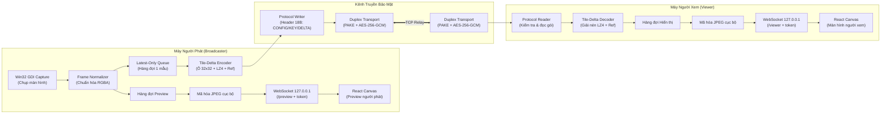
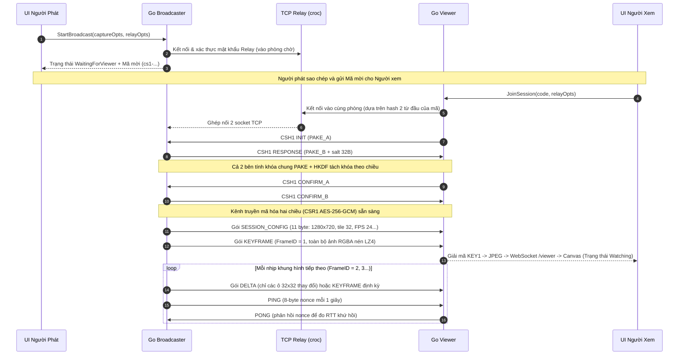

# Cẩm Nang Dự Án CrocStream (`PROJECT_GUIDE.md`)

Tài liệu này được biên soạn dành cho các thành viên trong nhóm, giảng viên hướng dẫn và người mới tiếp cận dự án **CrocStream**. Chỉ cần đọc tài liệu này, bạn có thể nắm vững bài toán, luồng hoạt động từ đầu đến cuối, kiến trúc mã nguồn, những đóng góp thực tế của nhóm so với repository gốc [`schollz/croc`](https://github.com/schollz/croc), cũng như kịch bản chạy demo và trả lời câu hỏi khi bảo vệ bài tập lớn.

---

## A. Tổng quan

### 1. Dự án này là gì?
**CrocStream** là ứng dụng desktop chia sẻ màn hình trực tiếp theo mô hình **1-1 (một người phát – một người xem)** trên hệ điều hành Windows 10/11 x64. Ứng dụng được xây dựng bằng **Go**, **Wails v3** và **React + TypeScript**, kế thừa nền tảng kết nối qua relay và thỏa thuận khóa mật khẩu **PAKE** của dự án mã nguồn mở nổi tiếng [`schollz/croc`](https://github.com/schollz/croc).

### 2. Dự án giải quyết vấn đề nào?
- **Hạn chế của dự án gốc (`schollz/croc`):** `croc` là công cụ dòng lệnh (CLI) rất mạnh để truyền file hoặc chia sẻ terminal văn bản (SSH) giữa hai máy tính thông qua một mã mời ngắn gọn. Tuy nhiên, kiến trúc của `croc` gắn chặt với vòng đời truyền file (cần biết trước kích thước file, metadata và kết thúc khi gửi hết file) nên **không thể truyền luồng hình ảnh màn hình thời gian thực** và không có giao diện đồ họa desktop để hiển thị hình ảnh liên tục.
- **Bài toán truyền hình ảnh màn hình:** Một khung hình độ phân giải `1280×720` ở định dạng ảnh thô RGBA nặng tới **3,68 MB** (`1280 × 720 × 4` byte). Nếu gửi 24 khung hình/giây mà không nén thông minh, băng thông tiêu tốn sẽ lên tới ~88 MB/giây. Trong khi đó, khi chia sẻ màn hình làm việc (soạn thảo văn bản, trình chiếu slide, lập trình), phần lớn diện tích màn hình đứng yên giữa hai khung hình liên tiếp.
- **Giải pháp của CrocStream:**
  1. Tách lớp truyền vận của `croc` thành một **kênh luồng byte hai chiều liên tục, có xác thực PAKE và mã hóa đầu cuối AES-256-GCM** mà không phụ thuộc vào metadata truyền file.
  2. Xây dựng **giao thức media nhị phân riêng (Media Protocol v1)** và **bộ mã hóa Tile-Delta xác định (Deterministic Tile-Delta Codec)**: chia màn hình thành các ô vuông `32×32` pixel, chỉ nén không mất dữ liệu (lossless LZ4) và gửi đi những ô thực sự thay đổi, đồng thời đo lường minh bạch mức băng thông tiết kiệm được theo thời gian thực.

### 3. Ai sẽ sử dụng và lợi ích thực tế là gì?
- **Đối tượng sử dụng:** Người dùng Windows cần chia sẻ màn hình nhanh và riêng tư với một người khác (hỗ trợ kỹ thuật từ xa, làm việc nhóm trong mạng LAN hoặc qua relay tự vận hành), cũng như sinh viên/kỹ sư nghiên cứu thực nghiệm về giao thức truyền thông đa phương tiện, mật mã PAKE và thuật toán nén delta.
- **Lợi ích thực tế:**
  - **Không cần tài khoản, không lưu dữ liệu lên đám mây:** Kết nối hoàn toàn bằng mã mời dùng một lần (`cs1-<6 từ khóa>`). Dừng phiên là mã mời lập tức bị hủy.
  - **Mã hóa đầu cuối (End-to-End Encryption):** Máy chủ relay chỉ làm nhiệm vụ ghép nối và chuyển tiếp các gói tin đã mã hóa, không thể đọc được hình ảnh màn hình.
  - **Tiết kiệm băng thông rõ rệt với số đo trung thực:** Giảm tới ~90–95% dung lượng truyền trên các tác vụ màn hình làm việc thông thường so với nén toàn bộ khung hình, và hiển thị trực tiếp phép so sánh ngay trên giao diện.

### 4. Ví dụ minh họa dễ hiểu
Hãy tưởng tượng **Minh** đang viết code trên laptop và muốn nhờ **Lan** (ngồi ở máy tính khác trong cùng mạng LAN hoặc kết nối qua một máy chủ relay chung) xem màn hình để cùng sửa lỗi:
1. Minh mở **CrocStream**, chọn **Chia sẻ màn hình**, chọn màn hình chính `1280×720 @ 24 FPS` và bấm **Bắt đầu chia sẻ**. Ứng dụng kết nối tới relay và sinh ra một mã mời bí mật (ví dụ `cs1-alpha-beta-...`).
2. Minh bấm **Sao chép mã** và gửi mã này cho Lan qua tin nhắn riêng.
3. Lan mở **CrocStream**, chọn **Tham gia bằng mã**, dán mã mời vào và bấm **Tham gia phiên**.
4. Hai ứng dụng tự động dùng mã mời đó để chứng minh danh tính với nhau bằng thuật toán **PAKE** (không bao giờ gửi mật khẩu dạng rõ qua mạng) và tạo khóa mã hóa riêng cho phiên.
5. Ngay sau đó, màn hình của Minh xuất hiện trực tiếp trên cửa sổ của Lan. Khi Minh chỉ gõ vài dòng chữ ở góc màn hình, CrocStream không gửi lại cả bức ảnh lớn mà chỉ gửi đúng vài ô vuông `32×32` chứa chữ vừa gõ. Khi xong việc, Minh bấm **Dừng chia sẻ**, kết nối đóng lại sạch sẽ và mã mời cũ không thể dùng lại được nữa.

---

## B. Luồng hoạt động (End-to-End Workflows)

Hệ thống gồm một giao diện người dùng bằng **React/TypeScript** (chạy trong cửa sổ WebView2 của Wails v3) và phần lõi xử lý bằng **Go**. Dưới đây là sơ đồ tổng thể và 3 luồng hoạt động quan trọng nhất.



### Luồng 1: Xem trước cục bộ (`Local Preview`)
Dùng để kiểm tra màn hình trên máy trước khi phát qua mạng:
1. Từ màn hình **Home**, người dùng bấm **Xem trước trên máy này** → giao diện gọi Wails RPC `ListDisplays()` để lấy danh sách màn hình từ Win32 API `EnumDisplayMonitors`.
2. Người dùng chọn màn hình, độ phân giải (`1280×720` hoặc `640×360`), tốc độ khung hình (`15`, `24`, hoặc `30` FPS) rồi bấm **Bắt đầu preview** (`StartPreview`).
3. Backend Go (`internal/preview`) mở một máy chủ WebSocket cục bộ tại `127.0.0.1:<cổng-ngẫu-nhiên>/preview` kèm một token bí mật 256-bit, trả địa chỉ và token này về cho React.
4. Worker chụp màn hình (`internal/capture`) chụp màn hình theo đúng nhịp FPS, chuẩn hóa điểm ảnh từ BGRA của Windows sang RGBA (`internal/frame`), rồi đẩy vào hàng đợi `latest-only` có sức chứa 1 khung hình.
5. Bộ điều khiển preview nén khung hình đó sang **JPEG** (`internal/bridge/jpeg.go`) và đẩy qua WebSocket cục bộ xuống React.
6. Hook `useFrameStream` trên React nhận dữ liệu nhị phân (`Blob`), giải mã bằng `createImageBitmap`, vẽ lên thẻ `<canvas>` theo đúng tỷ lệ 16:9 và gọi `bitmap.close()` ngay trong khối `finally` để không rò rỉ bộ nhớ GPU/RAM.

### Luồng 2: Chia sẻ và Xem màn hình giữa 2 máy (`Share` & `Watch`)



### Luồng 3: Tự động phục hồi lỗi (`PLI / Keyframe Recovery`) và Dừng phiên (`Stop / Leave`)
- **Phục hồi khi dữ liệu lỗi hoặc thiếu khung tham chiếu:**
  - Bộ giải mã của người xem (`internal/delta`) luôn kiểm tra toàn bộ gói `DELTA` (thứ tự `FrameID` phải tăng liên tiếp `lastVideoID + 1`, định dạng LZ4 hợp lệ, chỉ số các ô `tileIndex` tăng chặt, alpha = 255) **trước khi** cập nhật vào bộ đệm ảnh tham chiếu (canonical reference).
  - Nếu phát hiện gói lỗi hoặc bị nhảy số thứ tự `FrameID`, người xem **giữ nguyên khung hình tốt cuối cùng trên màn hình**, chuyển sang trạng thái `Recovering` (`Đang phục hồi ảnh`), đánh dấu tham chiếu không còn hợp lệ và gửi gói điều khiển `REQUEST_KEYFRAME` (**PLI** – giới hạn tối đa 1 lần/giây) ngược về người phát.
  - Ngay ở khung hình kế tiếp, bộ mã hóa của người phát bắt buộc phát một gói `KEYFRAME` đầy đủ để đồng bộ lại 100% ảnh tham chiếu giữa hai máy.
- **Dừng phiên an toàn:**
  - Khi người dùng bấm **Dừng chia sẻ**, **Rời phiên**, bấm nút **Quay về Home** hoặc đóng cửa sổ, hệ thống gửi gói `END` (`0xFF`) trong thời gian tối đa 200ms, sau đó hủy `context.Context`, đóng kết nối mạng, đóng WebSocket cục bộ, giải phóng tài nguyên chụp màn hình Win32 GDI, xóa mã mời/mật khẩu trong bộ nhớ và xóa sạch `<canvas>`.

---

## C. Kiến trúc dự án

### 1. Sơ đồ cấu trúc thư mục chính

```text
CrocStream/
├── README.md                  # Trang chủ giới thiệu ngắn gọn, hướng dẫn cài đặt & chạy nhanh
├── PROJECT_GUIDE.md           # Cẩm nang toàn diện hiểu hệ thống và bảo vệ đồ án (file này)
├── UPSTREAM.md                # Hồ sơ ghi nhận nguồn gốc và commit ghim của schollz/croc
├── AGENTS.md                  # Quy tắc kiến trúc, bảo mật và tiêu chuẩn chất lượng của dự án
├── croc/                      # [NGUYÊN BẢN - KHÔNG CHỈNH SỬA] Mã nguồn schollz/croc gốc làm đối chứng
├── app/                       # [PHẦN MỀM CHÍNH] Ứng dụng CrocStream Desktop
│   ├── main_windows.go        # Điểm khởi chạy (Entry point) tạo cửa sổ Wails v3 trên Windows
│   ├── wails.yaml             # Cấu hình build Wails v3.1.0
│   ├── go.mod / go.sum        # Khai báo thư viện Go của ứng dụng
│   ├── frontend/              # ---> GIAO DIỆN NGƯỜI DÙNG (React 19 + TypeScript)
│   │   ├── src/main.tsx       # Component gốc (Root) và màn hình trang chủ (Home)
│   │   ├── src/stream.tsx     # Màn hình Chia sẻ (Share) và Xem phiên (Watch)
│   │   ├── src/local-preview.tsx     # Màn hình Xem trước cục bộ (Local Preview)
│   │   ├── src/capture-settings.tsx  # Cụm điều khiển chọn màn hình, độ phân giải và FPS
│   │   ├── src/stream-metrics.tsx    # Bảng hiển thị số đo chính và mục Chi tiết luồng
│   │   ├── src/session-lifecycle.ts  # Bộ điều phối trạng thái phiên, chống xung đột Start/Stop/Poll
│   │   ├── src/latest.ts             # Bộ quản lý giải mã tối đa 1 ImageBitmap + 1 Blob mới nhất
│   │   └── src/hooks/                # Các React Hooks (useSession, useFrameStream, useDisplays)
│   ├── internal/              # ---> BỘ XỬ LÝ NGẦM BÊN DƯỚI - BACKEND (Go)
│   │   ├── desktop/           # Wails Service bindings gắn kết Go backend với React frontend
│   │   ├── session/           # Điều phối vòng đời phiên Share/Watch (Controller & Peer)
│   │   ├── preview/           # Điều phối vòng đời chế độ Xem trước cục bộ (Local Preview)
│   │   ├── capture/           # Chụp màn hình thực trên Windows bằng Win32 GDI (DPI-aware)
│   │   ├── frame/             # Chuẩn hóa mảng điểm ảnh BGRA/RGBA, cắt lề stride, ép alpha=255
│   │   ├── protocol/          # Đóng gói & phân tích cú pháp Media Protocol v1 (Header 18B, CONFIG 11B)
│   │   ├── delta/             # Bộ mã hóa/giải mã Tile-Delta 32x32 và nén không mất dữ liệu LZ4
│   │   ├── telemetry/         # Bộ đếm thống kê cửa sổ trượt 1 giây (FPS, KiB/s, Savings %, RTT)
│   │   ├── bridge/            # Máy chủ WebSocket 127.0.0.1 truyền ảnh JPEG cục bộ lên WebView
│   │   ├── crocduplex/        # Truyền vận bảo mật hai chiều (mã mời cs1-, PAKE & AES-256-GCM)
│   │   ├── transport/         # Lớp bọc kết nối từ session sang gói bảo mật crocduplex
│   │   └── latest/            # Hàng đợi giới hạn 1 phần tử (latest-only queue) chống nghẽn
│   └── cmd/
│       ├── demo-relay/        # Chương trình crocstream-relay.exe phục vụ chạy demo
│       └── qa-probes/         # Các trình thực thi kiểm thử chuyên sâu (transport/session/origin)
├── packaging/                 # [ĐÓNG GÓI & DEMO] Tạo gói Portable ZIP, bật relay & hướng dẫn Demo
├── scripts/                   # [CÔNG CỤ TỰ ĐỘNG] verify.ps1, clean.ps1, toolchain/, notices/, qa-probes/
└── docs/                      # [TÀI LIỆU 3 NGĂN]
    ├── GETTING_STARTED.md     # 1. Hướng dẫn khởi động nhanh trong vài phút cho người dùng
    ├── specs/                 # 2. Bản vẽ thiết kế kỹ thuật (PRD, ARCHITECTURE, TEST_PLAN, ROADMAP)
    └── archive-gates/         # 3. Hồ sơ & bằng chứng nghiệm thu lịch sử G0–G6 (reports/, evidence/, licenses/)
```

### 2. Các thành phần giao tiếp với nhau như thế nào?
Ứng dụng tách bạch rõ ràng **3 kênh giao tiếp** để vừa đảm bảo hiệu năng thời gian thực, vừa đảm bảo an toàn:
1. **Kênh điều khiển & số đo nội bộ (React ↔ Go qua Wails v3 Service Bindings):**
   - Giao diện gọi các hàm Go được khai báo trong [`app/internal/desktop/service_windows.go`](app/internal/desktop/service_windows.go) (`ListDisplays`, `StartPreview`, `StopPreview`, `GetStats`, `StartBroadcast`, `JoinSession`, `StopSession`, `GetSessionStats`, `GetInvitation`).
   - Giao diện chỉ hỏi (poll) trạng thái và số đo mỗi **500 ms/lần**. **Tuyệt đối không gửi dữ liệu ảnh qua Wails RPC hay chuỗi Base64** để tránh làm nghẽn luồng sự kiện giao diện.
2. **Kênh hiển thị hình ảnh nội bộ (Go ↔ React Canvas qua Binary Loopback WebSocket):**
   - Khi bắt đầu một phiên (`Start`), [`app/internal/bridge/bridge.go`](app/internal/bridge/bridge.go) mở một cổng TCP ngẫu nhiên chỉ lắng nghe trên `127.0.0.1` với đường dẫn `/preview` (cho người phát) hoặc `/viewer` (cho người xem).
   - Trình duyệt WebView kết nối WebSocket kèm token ngẫu nhiên 256-bit trong header `Sec-WebSocket-Protocol: crocstream.preview, auth.<token>` và được kiểm tra nghiêm ngặt `Origin` (`http://wails.localhost`).
   - Go chuyển khung hình RGBA hiện tại thành ảnh **JPEG** chất lượng 75 và gửi dưới dạng binary frame qua WebSocket để React vẽ thẳng lên `<canvas>`.
3. **Kênh truyền thông đa phương tiện giữa hai máy (Go Broadcaster ↔ Relay ↔ Go Viewer):**
   - [`app/internal/session/peer.go`](app/internal/session/peer.go) ghi và đọc các gói tin của **Media Protocol v1** (`SESSION_CONFIG`, `KEYFRAME`, `DELTA`, `REQUEST_KEYFRAME`, `PING`, `PONG`, `END`) qua một giao diện chuẩn `io.ReadWriteCloser`.
   - Giao diện `io.ReadWriteCloser` này được cung cấp bởi [`app/internal/crocduplex/transport/transport.go`](app/internal/crocduplex/transport/transport.go), nơi mọi byte dữ liệu đều đã được xác thực hai chiều bằng PAKE và mã hóa bằng AES-256-GCM.

### 3. Bảng tra cứu nhanh: Muốn sửa một chức năng thì tìm ở đâu?

| Nhu cầu chỉnh sửa / tìm hiểu | File cần mở |
| --- | --- |
| Điểm khởi chạy ứng dụng, kích thước cửa sổ mặc định (`1150×760`) | [`app/main_windows.go`](app/main_windows.go) |
| Giao diện trang chủ, chuyển đổi giữa 3 chế độ (Share / Watch / Preview) | [`app/frontend/src/main.tsx`](app/frontend/src/main.tsx) |
| Giao diện màn hình Chia sẻ & Xem phiên, nút Sao chép mã, ô nhập Relay | [`app/frontend/src/stream.tsx`](app/frontend/src/stream.tsx) |
| Bảng số đo FPS, tốc độ `KiB/s`, RTT và mục mở rộng `Chi tiết luồng` | [`app/frontend/src/stream-metrics.tsx`](app/frontend/src/stream-metrics.tsx) |
| Logic chọn màn hình, độ phân giải (`1280×720`, `640×360`) và FPS (`15/24/30`) | [`app/frontend/src/capture-settings.tsx`](app/frontend/src/capture-settings.tsx), [`app/internal/protocol/config.go`](app/internal/protocol/config.go) |
| Kết nối WebSocket nhận ảnh JPEG và vẽ lên `<canvas>` | [`app/frontend/src/hooks/useFrameStream.ts`](app/frontend/src/hooks/useFrameStream.ts), [`app/frontend/src/latest.ts`](app/frontend/src/latest.ts) |
| Thuật toán chia ô `32×32`, tính sai số màu `RGB MAE > tau`, nén/giải nén LZ4 | [`app/internal/delta/codec.go`](app/internal/delta/codec.go), [`app/internal/delta/record.go`](app/internal/delta/record.go), [`app/internal/delta/compression.go`](app/internal/delta/compression.go) |
| Cấu trúc gói tin 18-byte Header và 11-byte `SESSION_CONFIG` | [`app/internal/protocol/header.go`](app/internal/protocol/header.go), [`app/internal/protocol/stream.go`](app/internal/protocol/stream.go) |
| Vòng lặp chụp màn hình Windows bằng Win32 GDI | [`app/internal/capture/capture_windows.go`](app/internal/capture/capture_windows.go) |
| Điều phối phiên phát/xem, giới hạn thử lại (rate limit) và gửi/nhận gói tin | [`app/internal/session/controller.go`](app/internal/session/controller.go), [`app/internal/session/peer.go`](app/internal/session/peer.go) |
| Công thức tính băng thông `KiB/s`, baseline LZ4 và `%` tiết kiệm trong cửa sổ 1 giây | [`app/internal/telemetry/meter.go`](app/internal/telemetry/meter.go) |
| Sinh mã mời `cs1-`, bắt tay PAKE và mã hóa bản ghi AES-256-GCM qua relay `croc` | [`app/internal/crocduplex/transport/transport.go`](app/internal/crocduplex/transport/transport.go), [`app/internal/crocduplex/upstreampake/pake.go`](app/internal/crocduplex/upstreampake/pake.go) |

---

## D. Repository gốc (`schollz/croc`) so với dự án hiện tại (`CrocStream`)

Dự án được phát triển dựa trên phiên bản gốc **`schollz/croc`** tại commit **`552f40fd2d7593316118370bec0a93478d48e715`** (ngay sau tag `v11.6.5`, Git tree hash `0e401898d47eaef76e62263483943e3aa789ad3a`). Toàn bộ mã nguồn gốc được giữ nguyên vẹn 100% trong thư mục [`croc/`](croc) (được kiểm tra tự động bởi GitHub Actions CI và `Inspect-Environment.ps1`).

### 1. Bảng so sánh tổng hợp

| Tiêu chí | Repository gốc (`schollz/croc`) | Dự án hiện tại (`CrocStream`) | Giá trị cải tiến mang lại |
| --- | --- | --- | --- |
| **Mục đích & Tính năng chính** | Truyền file/thư mục tĩnh (`Send`/`Receive`) và chia sẻ terminal dòng lệnh (`sshshare`). | Chia sẻ màn hình desktop thời gian thực 1-1 (`Share`/`Watch`), xem trước cục bộ (`Local Preview`), kèm tiện ích relay demo. | Mở rộng từ công cụ truyền file tĩnh thành ứng dụng truyền luồng hình ảnh thời gian thực có kiểm soát trạng thái. |
| **Khả năng sử dụng & Giao diện** | Giao diện dòng lệnh (CLI) và web client phụ trợ cho truyền file/SSH; không có cửa sổ xem màn hình desktop. | Ứng dụng Desktop Windows gốc (Wails v3 + React/TypeScript), hiển thị canvas 16:9, khóa cấu hình khi đang phát, hỗ trợ bàn phím/accessibility. | Người dùng cuối thao tác trực quan bằng giao diện đồ họa, xem trực tiếp màn hình và trạng thái kết nối rõ ràng. |
| **Kiến trúc truyền thông** | Kết nối relay và bắt tay PAKE gắn chặt với metadata của file (`filesInfo`, `TypeFinished`) hoặc phiên terminal SSH; `comm.Comm` không phải là `io.ReadWriteCloser`. | Tách lớp `duplex` transport (`io.ReadWriteCloser`) độc lập với truyền file; định nghĩa bản ghi mã hóa `CSR1` có khóa AES-256-GCM tách biệt theo hai chiều gửi/nhận và số thứ tự chống phát lại (replay). | Cho phép truyền luồng byte hai chiều liên tục trong thời gian dài (đã kiểm chứng các phiên $\ge 600$ giây) và gửi tín hiệu điều khiển ngược trên cùng kết nối. |
| **Xử lý dữ liệu & Codec** | Đọc/ghi trực tiếp khối byte của file từ ổ đĩa. Không có xử lý điểm ảnh hay nén video theo vùng thay đổi. | Chuẩn hóa điểm ảnh RGBA, chia lưới ô `32×32`, lọc nhiễu theo ngưỡng `RGB MAE > tau`, nén không mất dữ liệu bằng LZ4 frame, đồng bộ ảnh tham chiếu chuẩn (canonical reference) và tự phục hồi bằng `KEYFRAME`/PLI. | Giảm mạnh băng thông truyền khi màn hình ít biến động (~90–95% trên desktop làm việc) trong khi vẫn đảm bảo ảnh khôi phục tại máy xem khớp từng byte với ảnh chuẩn của máy phát. |
| **Bảo mật & Cô lập giao thức** | Gói `pakekey` chỉ cho phép 3 mục đích: `peer-transfer`, `local-ip-probe`, `peer-ssh`. | Dẫn xuất gói `upstreampake` với namespace mục đích riêng `peer-crocstream-g0-v1` và tiền tố mã mời `cs1-`, kết hợp băm tên phòng `SHA-256("crocstream/room/g0-v1\x00" + room)`. | Đảm bảo cô lập mật mã: client `croc` truyền file thông thường không thể kết nối nhầm hoặc giải mã phiên truyền màn hình của CrocStream. |
| **Đo lường & Quan sát (Telemetry)** | Thanh tiến trình phần trăm dung lượng file (`progressbar`). | Bộ đo cửa sổ trượt 1 giây chính xác (`internal/telemetry`): FPS từng công đoạn, tốc độ video `KiB/s`, baseline nén toàn ảnh `KiB/s` trên cùng mẫu, `%` tiết kiệm, RTT khứ hồi. | Cung cấp số liệu thực nghiệm khách quan để chứng minh hiệu quả của thuật toán nén Tile-Delta ngay trong lúc chạy demo. |

### 2. Phân định rõ ràng các phần mã nguồn (Kế thừa – Chỉnh sửa – Phát triển mới)

1. **Phần kế thừa nguyên vẹn từ `schollz/croc` (nằm trong [`croc/`](croc)):**
   - Giữ nguyên 100% mã nguồn và giấy phép MIT của tác giả Zack Scholl.
   - Ứng dụng mới trong `app/` chỉ import và tái sử dụng 3 gói thư viện nền tảng từ `croc/`:
     - `croc/src/codephrase`: Hàm `GenerateSSH()` và `ParseSSH()` cùng danh sách từ khóa EFF để sinh và tách mã mời 6 từ.
     - `croc/src/tcp`: Hàm `ConnectToTCPServerControlContext()` để kết nối vào phòng chờ trên relay TCP, và `RunWithListener()` để chạy máy chủ relay trong `cmd/demo-relay` và các bộ test.
     - `croc/src/crypt`: Các hàm nguyên thủy `NewAESGCM()`, `EncryptAEADTo()`, `DecryptAEAD()` dùng cho mã hóa xác thực AES-GCM.
2. **Phần dẫn xuất có chỉnh sửa có kiểm soát (nằm trong [`app/internal/crocduplex/upstreampake/pake.go`](app/internal/crocduplex/upstreampake/pake.go) – 124 dòng code):**
   - Được dẫn xuất từ `croc/src/pakekey/pakekey.go` (kèm đầy đủ ghi chú nguồn gốc trong `UPSTREAM.md` và `LICENSE` cùng thư mục).
   - Thay đổi duy nhất: Cố định hằng số `Purpose = "peer-crocstream-g0-v1"` và đường cong elliptic `Curve = "p256"`, giữ nguyên công thức đóng gói transcript, dẫn xuất khóa 96-byte bằng `HKDF-SHA256` và thẻ xác nhận hai chiều `HMAC-SHA256`.
3. **Phần do nhóm phát triển mới hoàn toàn (toàn bộ thư mục [`app/`](app), [`packaging/`](packaging), [`docs/`](docs), [`scripts/`](scripts), [`.github/workflows/`](.github/workflows)):**
   - Giao thức bắt tay `CSH1` và tầng bản ghi mã hóa hai chiều `CSR1` (`app/internal/crocduplex/transport`).
   - Giao thức truyền thông đa phương tiện **Media Protocol v1** (`app/internal/protocol`).
   - Bộ chuẩn hóa khung hình (`app/internal/frame`) và bộ mã hóa/giải mã **Tile-Delta + LZ4** (`app/internal/delta`).
   - Hệ thống đo lường cửa sổ trượt 1 giây (`app/internal/telemetry`).
   - Bộ chụp màn hình Windows bằng Win32 GDI (`app/internal/capture`) và cầu nối WebSocket loopback bảo mật (`app/internal/bridge`).
   - Bộ điều phối phiên truyền hình ảnh và xem trước (`app/internal/session`, `app/internal/preview`), dịch vụ Wails v3 (`app/internal/desktop`), tiện ích relay demo (`app/cmd/demo-relay`), bộ đóng gói (`packaging/`) và toàn bộ giao diện React/TypeScript (`app/frontend`).

---

## E. Giải thích kỹ thuật dành cho sinh viên (Chuẩn bị trả lời câu hỏi bảo vệ)

### 1. Giải thích nhanh các thuật ngữ kỹ thuật trong dự án
- **Relay (Máy chủ chuyển tiếp):** Máy chủ trung gian giúp hai máy tính (vốn nằm sau tường lửa hoặc modem mạng khác nhau) tìm thấy nhau thông qua tên phòng và chuyển tiếp các gói tin đã mã hóa giữa hai bên.
- **PAKE (Password-Authenticated Key Exchange):** Giao thức mật mã cho phép hai máy tính cùng biết một mật khẩu ngắn (mã mời) thỏa thuận được một khóa mã hóa mạnh (256-bit) qua mạng mà **không bao giờ gửi mật khẩu đó qua đường truyền**. Kẻ nghe lén trên mạng hay chính máy chủ relay cũng không thể đoán hay lấy được khóa.
- **AEAD / AES-256-GCM (Authenticated Encryption with Associated Data):** Chuẩn mã hóa vừa bảo mật nội dung dữ liệu, vừa gắn kèm một thẻ xác thực (authentication tag 16 byte). Nếu dữ liệu bị sửa đổi dù chỉ 1 bit trên đường truyền, bước giải mã sẽ phát hiện và từ chối ngay lập tức.
- **RGBA (Red - Green - Blue - Alpha):** Cách biểu diễn mỗi điểm ảnh (pixel) bằng 4 byte liên tiếp: Đỏ, Xanh lá, Xanh dương và Độ đục (`Alpha = 255` là đặc hoàn toàn).
- **Tile-Delta & Dirty Tile (Nén phần thay đổi theo ô):** Thay vì gửi lại cả bức ảnh, hệ thống chia bức ảnh thành các ô vuông `32×32` pixel (ở độ phân giải `1280×720` có `40 × 23 = 920` ô; ở `640×360` có `20 × 12 = 240` ô). Ô nào có màu sắc thay đổi vượt ngưỡng so với ảnh trước đó thì gọi là **dirty tile** (ô bẩn/ô thay đổi) và chỉ những ô đó mới được đóng gói gửi đi.
- **RGB MAE & Ngưỡng `tau` (Mean Absolute Error):** Độ lệch màu trung bình tuyệt đối trên 3 kênh R, G, B của một ô giữa khung hình mới chụp và ảnh tham chiếu:
  $$\text{MAE} = \frac{\sum (|R_1 - R_2| + |G_1 - G_2| + |B_1 - B_2|)}{3 \times \text{Số điểm ảnh của ô}}$$
  Nếu $\text{MAE} > \tau$ (mặc định $\tau = 4$), ô đó được coi là có thay đổi. Việc chọn $\tau = 4$ giúp bỏ qua các nhiễu màu cực nhỏ mà mắt thường khó nhận ra; khi đặt $\tau = 0$, mọi thay đổi dù chỉ 1 đơn vị màu cũng đều được truyền đi nguyên vẹn.
- **Canonical Reference (Ảnh tham chiếu chuẩn):** Bức ảnh chuẩn đang được lưu trong bộ nhớ của cả máy phát và máy xem. Máy phát luôn so sánh ảnh mới chụp với **ảnh tham chiếu chuẩn đã thực sự gửi đi** (chứ không phải ảnh chụp thô trước đó), nhờ vậy hai máy không bao giờ bị lệch ảnh cộng dồn theo thời gian.
- **PLI (`REQUEST_KEYFRAME` – Picture Loss Indication):** Tín hiệu do máy người xem gửi ngược về máy người phát để yêu cầu gửi lại một bức ảnh gốc đầy đủ (`KEYFRAME`) khi máy xem phát hiện mất gói hoặc lỗi giải mã.
- **Backpressure & Latest-Only Queue (Chống nghẽn bằng hàng đợi giữ mẫu mới nhất):** Khi màn hình được chụp nhanh hơn tốc độ mạng hoặc tốc độ nén, thay vì xếp hàng hàng trăm khung hình làm đầy RAM và gây trễ hình (lag), hàng đợi kích thước 1 (`internal/latest`) sẽ bỏ khung hình cũ chưa kịp nén để thay bằng khung hình vừa chụp mới nhất.

### 2. Trả lời 7 câu hỏi cốt lõi khi bảo vệ đồ án

#### Câu 1: Hệ thống hoạt động theo cơ chế tổng thể nào?
Hệ thống hoạt động theo đường ống (pipeline) đồng bộ trạng thái giữa hai đầu:
1. **Thiết lập kênh bảo mật:** Hai máy dùng mã mời `cs1-...` kết nối qua TCP Relay, chạy giao thức **PAKE (`p256`)** để xác thực lẫn nhau và sinh cặp khóa **AES-256-GCM** riêng cho từng chiều truyền.
2. **Thỏa thuận cấu hình:** Máy phát gửi gói `SESSION_CONFIG` (11 byte) quy định độ phân giải (`1280×720` hoặc `640×360`), kích thước ô (`32×32`), FPS mục tiêu (`15/24/30`) và chu kỳ khung khóa `KeyInterval` (mặc định mỗi 30 khung hình).
3. **Truyền hình ảnh:** Khung hình đầu tiên bắt buộc là `KEYFRAME` (`FrameID = 1`) chứa toàn bộ ảnh RGBA được nén không mất dữ liệu bằng **LZ4 frame**. Các khung hình tiếp theo là gói `DELTA` chỉ chứa danh sách các ô `32×32` có thay đổi, hoặc chuyển sang `KEYFRAME` nếu số ô thay đổi vượt quá **65%** diện tích màn hình, đến chu kỳ `KeyInterval`, hoặc nhận được yêu cầu `PLI` từ người xem.
4. **Hiển thị cục bộ:** Ở cả hai máy, bức ảnh RGBA chuẩn sau khi chụp/giải mã được lấy mẫu sang một luồng riêng, nén thành **JPEG** trong RAM và đẩy qua **WebSocket cục bộ (`127.0.0.1`)** để giao diện React vẽ lên `<canvas>`.

#### Câu 2: Tại sao nhóm lựa chọn các công nghệ hiện tại?
- **Go (Golang):** Dự án gốc `croc` viết bằng Go. Go hỗ trợ xử lý đồng thời (goroutines, channels), quản lý mạng nhị phân (`io.ReadFull`) và gọi trực tiếp Win32 API (`golang.org/x/sys/windows`) rất hiệu quả mà không cần cài thêm thư viện C/C++ phức tạp (`CGO_ENABLED=0` cho bản build production).
- **Wails v3 + React 19 + TypeScript:** Thay vì dùng Electron (nặng hàng trăm MB vì đóng gói cả nhân Chromium riêng), Wails v3 tận dụng sẵn **Microsoft Edge WebView2** của Windows nên file thực thi `crocstream.exe` chỉ nặng khoảng **13,2 MB**, khởi động nhanh và giao tiếp trực tiếp với các hàm Go có kiểu dữ liệu chặt chẽ (TypeScript bindings).
- **LZ4 Frame (`pierrec/lz4/v4`) kết hợp JPEG cục bộ:**
  - *Trên đường truyền mạng:* Phải dùng nén **không mất dữ liệu (Lossless LZ4)** vì nếu dùng nén có mất dữ liệu (như JPEG) để ghép các ô `DELTA` chồng lên ảnh cũ qua hàng trăm khung hình, sai số nén sẽ cộng dồn làm hình ảnh bị vỡ và nhòe. LZ4 có tốc độ nén và giải nén cực nhanh (chỉ vài mili-giây cho một khung hình 720p trên CPU hiện đại) và hỗ trợ sẵn checksum kiểm tra toàn vẹn.
  - *Khi vẽ lên giao diện WebView:* API `createImageBitmap` của trình duyệt giải mã ảnh `image/jpeg` bằng phần cứng rất nhanh và không đọc trực tiếp mảng byte RGBA thô, nên việc chuyển ảnh chuẩn sang JPEG ở bước cuối cùng (chỉ để hiển thị, không ảnh hưởng tới ảnh tham chiếu `canonical reference`) giúp giao diện đạt tốc độ 24 FPS mượt mà.

#### Câu 3: Chức năng quan trọng nhất (Codec Tile-Delta & chống lệch ảnh) được triển khai như thế nào?
Nằm trong gói [`app/internal/delta`](app/internal/delta/codec.go):
- **Tại bộ mã hóa (`Encoder.Emit`):**
  1. Kiểm tra khung hình đầu vào phải đúng kích thước `Width × Height × 4` byte và mọi điểm ảnh đều có `Alpha = 255`.
  2. Tính gói nén LZ4 toàn khung hình (`baseline`) để phục vụ phép đo đối chiếu công bằng.
  3. Nếu là khung đầu tiên (`id == 1`), hoặc đến chu kỳ `(id - 1) % KeyInterval == 0`, hoặc có cờ `forceKey` (do nhận PLI), bộ mã hóa phát ngay gói `KEYFRAME`.
  4. Ngược lại, hàm `dirtyTiles()` duyệt qua từng ô `32×32`, tính tổng độ lệch tuyệt đối $|\Delta R| + |\Delta G| + |\Delta B|$ giữa khung mới và `e.reference` (ảnh tham chiếu chuẩn). Sử dụng phép nhân số nguyên chính xác `sum > int(tau) * 3 * w * h` (tránh sai số dấu chấm động) để xác định các ô thay đổi.
  5. Nếu tỷ lệ ô thay đổi $> 65\%$ (`len(indices)*100 > TileCount*65`), tự động chuyển sang phát `KEYFRAME`. Nếu $\le 65\%$, đóng gói bản ghi `DELTA` (`uint16 dirtyCount` + chuỗi `[uint16 tileIndex, byte[] tileRGBA]`), nén bằng LZ4 và gửi đi.
  6. **Điểm mấu chốt:** Chỉ những ô thực sự được gửi trong gói `DELTA` mới được chép đè vào `e.reference` (các ô có thay đổi nhỏ hơn ngưỡng `tau` bị bỏ qua thì trong `e.reference` vẫn giữ nguyên giá trị cũ), và `e.reference` **chỉ được cập nhật sau khi `w.WritePacket(p)` ghi xuống mạng thành công**.
- **Tại bộ giải mã (`Decoder.Decode`):**
  1. Kiểm tra header, thứ tự `FrameID` và gọi `singleFrame()` để kiểm tra khung LZ4 hợp lệ trước khi giải nén với giới hạn cứng `limit + 1` byte (chống tấn công bom giải nén – compression bomb).
  2. Với gói `DELTA`, hàm `DecodeDelta()` kiểm tra toàn bộ danh sách ô (`dirtyCount <= TileCount`, chỉ số `tileIndex` phải tăng dần nghiêm ngặt để chống gửi trùng ô làm tràn bộ nhớ, độ dài khớp tuyệt đối).
  3. Tạo bản sao tạm `next := bytes.Clone(d.reference)`, chép các ô mới vào `next`, và khi mọi bước hoàn tất không có lỗi mới gán `d.reference = next`. Nếu có bất kỳ lỗi nào ở giữa chừng, `d.reference` cũ vẫn nguyên vẹn 100%.

#### Câu 4: Module nào chịu trách nhiệm xử lý chính?
- **Điều phối trung tâm:** [`app/internal/session`](app/internal/session) (`controller.go` quản lý vòng đời phiên/worker/cleanup; `peer.go` quản lý luồng đọc `receive` và luồng ghi duy nhất `Run`).
- **Xử lý hình ảnh & nén:** [`app/internal/delta`](app/internal/delta) và [`app/internal/protocol`](app/internal/protocol).
- **Bảo mật & kết nối mạng:** [`app/internal/crocduplex/transport`](app/internal/crocduplex/transport) và [`app/internal/crocduplex/upstreampake`](app/internal/crocduplex/upstreampake).

#### Câu 5: Dữ liệu được lưu trữ và truy xuất ra sao?
- Dự án **không sử dụng cơ sở dữ liệu (Database)** và **không bao giờ lưu ảnh chụp màn hình, mã mời hay mật khẩu xuống ổ đĩa**.
- Toàn bộ dữ liệu hoạt động trong **RAM với kích thước giới hạn cứng (bounded memory)**:
  - Ảnh tham chiếu chuẩn (`reference []byte`): tối đa `3.686.400` byte (1280×720×4) mỗi chiều.
  - Hàng đợi khung hình chụp (`frames`) và hàng đợi hiển thị (`images`, `bridge.queue`): đều là channel có sức chứa đúng **1 phần tử** (`make(chan ..., 1)`).
  - Số liệu thống kê (`telemetry.Meter`): lưu trong một mảng vòng cố định **4096 sự kiện** (`ring [4096]entry`), tự động loại bỏ các sự kiện cũ hơn 1 giây.
  - Mật khẩu relay và mã mời trong bộ nhớ sẽ bị xóa trắng (`""` hoặc `clear()`) ngay sau khi hoàn tất xác thực hoặc khi dừng phiên.

#### Câu 6: Điểm khó kỹ thuật nằm ở đâu và nhóm đã giải quyết như thế nào?
1. **Chống hiện tượng trôi/lệch ảnh (Sender-Viewer Drift) khi có lọc nhiễu (`tau > 0`):**
   - *Vấn đề:* Nếu một vùng màn hình thay đổi độ sáng rất chậm (mỗi khung hình chỉ đổi 1 đơn vị màu, nhỏ hơn `tau = 4`), nếu máy phát so sánh khung hình mới với *khung hình vừa chụp trước đó*, nó sẽ không bao giờ gửi ô đó đi, dẫn tới màn hình người xem bị lệch hẳn so với màn hình thật.
   - *Giải pháp:* Máy phát chỉ cập nhật ảnh tham chiếu `e.reference` cho những ô đã thực sự được truyền đi. Nhờ vậy, các thay đổi nhỏ 1 đơn vị mỗi khung hình sẽ tích lũy dần so với `e.reference`; đến khi tổng độ lệch vượt quá 4, ô đó sẽ được gửi đi và hai máy luôn hội tụ chính xác từng byte (đã được chứng minh qua bài test 201 khung hình liên tiếp `TestSubthresholdAccumulatesAgainstTransmittedReference`).
2. **Xử lý nghẽn mạng (Backpressure) trên giao thức Delta mà không làm hỏng ảnh:**
   - *Vấn đề:* Vì gói `DELTA` thứ $N$ phụ thuộc vào kết quả của gói thứ $N-1$, nếu mạng chậm mà ta tự ý vứt bỏ một gói `DELTA` đã mã hóa ở giữa, tất cả các gói `DELTA` phía sau sẽ ghép sai ảnh.
   - *Giải pháp:* Chỉ được phép bỏ khung hình thô **trước khi đưa vào bộ mã hóa** (thông qua hàng đợi `latest.Offer` kích thước 1). Một khi khung hình đã được bộ mã hóa chọn và gán `FrameID`, gói tin đó bắt buộc phải được gửi tuần tự qua một writer duy nhất.
3. **Truyền hình ảnh tốc độ cao từ Go lên giao diện WebView mà không gây giật lag:**
   - *Vấn đề:* Cơ chế sự kiện/RPC của các framework desktop thường tuần tự hóa dữ liệu sang JSON/Base64, làm tăng kích thước ảnh thêm 33% và gây tốn CPU/GC trong JavaScript.
   - *Giải pháp:* Tách riêng kênh dữ liệu bằng máy chủ **Binary WebSocket trên `127.0.0.1`** với xác thực token qua subprotocol và kiểm tra `Origin`. Phía React giữ dữ liệu điểm ảnh hoàn toàn bên ngoài React State, dùng `LatestFrames` kết hợp `requestAnimationFrame` và `createImageBitmap` để luôn vẽ khung hình mới nhất và giải phóng `bitmap.close()` ngay lập tức.
4. **Đảm bảo an toàn đa luồng khi dừng phiên (`Stop` / `Disconnect`) hoặc khi RPC bất đồng bộ trả về trễ:**
   - *Vấn đề:* Trên giao diện hoặc trong hệ thống mạng, người dùng có thể bấm `Start` rồi bấm `Stop` ngay khi kết nối còn đang lơ lửng, hoặc hàm lấy mã mời `GetInvitation` trả về chậm sau khi phiên đã ngắt kết nối.
   - *Giải pháp:* Ở Frontend, lớp `SessionLifecycle` gắn số hiệu `revision` cho mỗi thao tác RPC và `generation` cho mỗi phiên của backend, đồng thời tách việc hỏi mã mời ra khỏi vòng lặp hỏi trạng thái 500ms để không bao giờ bị treo giao diện. Ở Backend Go, mỗi worker đều lắng nghe `context.Context` và dùng `sync.WaitGroup` + `time.AfterFunc(200ms)` để đóng socket đang bị chặn I/O, đảm bảo thu hồi toàn bộ goroutine và đối tượng GDI trong vòng vài trăm mili-giây.

#### Câu 7: Khi muốn cải tiến hoặc mở rộng thêm thì nên bắt đầu từ đâu?
- **Thêm nguồn thu từ Webcam hoặc âm thanh (Mốc G7 trong Roadmap):** Chỉ cần cài đặt một struct mới thỏa mãn interface `capture.System` trong [`app/internal/capture/capture.go`](app/internal/capture/capture.go) mà không cần sửa đổi codec hay giao thức mạng.
- **Hỗ trợ đa nền tảng (macOS / Linux):** Các gói `protocol`, `delta`, `telemetry`, `session`, `bridge` và `transport` đều đã là Go thuần (pure Go) không phụ thuộc hệ điều hành. Chỉ cần bổ sung file cài đặt `capture_darwin.go` / `capture_linux.go` tương ứng với `capture_windows.go` và cập nhật danh sách `Origin` của WebView trên hệ điều hành đó.
- **Tối ưu thêm hiệu năng bộ nhớ:** Có thể tái sử dụng bộ đệm khung hình (`[]byte` scratch buffer) bên trong `delta.Encoder`/`Decoder` và bộ đệm nén JPEG để giảm số lần cấp phát bộ nhớ trên mỗi khung hình.

---

## F. Hướng dẫn Demo và Bảo vệ trước Giảng viên

Dưới đây là kịch bản trình bày và demo thực tế trong khoảng **5–7 phút**, đi thẳng vào trọng tâm chấm điểm của môn học.

### Bước 1: Nêu vấn đề ban đầu (30 giây)
> *"Thưa thầy/cô, nhóm chúng em chọn dự án gốc là `schollz/croc` – một công cụ truyền dữ liệu điểm-tới-điểm rất phổ biến viết bằng Go, sử dụng mã mời ngắn và giao thức thỏa thuận khóa mật khẩu PAKE. Tuy nhiên, `croc` gốc chỉ hỗ trợ truyền file tĩnh hoặc chia sẻ cửa sổ dòng lệnh SSH, chưa hỗ trợ truyền luồng hình ảnh màn hình thời gian thực và chưa có ứng dụng đồ họa desktop. Vì vậy, nhóm đã phát triển **CrocStream** để mở rộng nền tảng bảo mật của `croc` sang bài toán chia sẻ màn hình desktop 1-1 thời gian thực kèm đo lường hiệu quả nén."*

### Bước 2: Giới thiệu giải pháp của nhóm (1 phút)
Trình bày ngắn gọn 3 trụ cột mà nhóm đã xây dựng trong thư mục `app/` (trong khi vẫn giữ nguyên vẹn mã nguồn `croc/` gốc để đối chiếu):
1. **Kênh truyền bảo mật hai chiều (`internal/crocduplex`):** Tách quá trình vào phòng relay và bắt tay PAKE của `croc` thành một luồng `io.ReadWriteCloser` hai chiều liên tục, có khóa AES-256-GCM riêng cho từng chiều và namespace mật mã độc lập (`peer-crocstream-g0-v1`).
2. **Giao thức Media v1 & Codec Tile-Delta (`internal/protocol`, `internal/delta`):** Thiết kế gói tin nhị phân 18-byte header, chia khung hình thành lưới ô vuông `32×32`, chỉ nén không mất dữ liệu bằng LZ4 những ô có độ lệch màu `RGB MAE > tau`, giữ ảnh tham chiếu chuẩn để không bao giờ bị lệch ảnh, và hỗ trợ tự động phục hồi bằng tín hiệu PLI (`REQUEST_KEYFRAME`).
3. **Ứng dụng Desktop Windows & Dashboard đo lường (`internal/capture`, `internal/bridge`, `frontend`):** Chụp màn hình bằng Win32 GDI, đẩy ảnh JPEG cục bộ qua WebSocket loopback `127.0.0.1` lên canvas React, và đo lường công bằng tỷ lệ tiết kiệm băng thông trong cửa sổ trượt 1 giây.

### Bước 3: Thao tác chạy Demo trực tiếp (3 phút)
Chuẩn bị sẵn thư mục đã giải nén từ gói Portable ZIP (hoặc bản build trong `app/bin/`):

1. **Thử tính năng Xem trước cục bộ (30 giây):**
   - Mở `crocstream.exe`, bấm **Xem trước trên máy này**.
   - Chọn màn hình, chọn `1280 × 720` và `24 FPS`, bấm **Bắt đầu preview**.
   - Chỉ cho giảng viên thấy hình ảnh màn hình xuất hiện mượt mà ở tốc độ ~24 FPS mà chưa cần mạng, sau đó bấm **Dừng preview** và quay về **Home**.
2. **Khởi động Relay Demo (30 giây):**
   - Mở PowerShell, chạy `.\Start-DemoRelay.ps1` (mặc định lắng nghe tại `127.0.0.1:9009`, hoặc nhập IP LAN nếu demo trên 2 laptop).
   - Nhập mật khẩu relay (ví dụ `crocstream-demo-2026`, tối thiểu 12 ký tự) – nhấn mạnh rằng mật khẩu được truyền qua ống `stdin` riêng tư, không lộ trên dòng lệnh.
3. **Kết nối Chia sẻ & Xem giữa 2 cửa sổ ứng dụng (2 phút):**
   - Trên **Cửa sổ 1 (Người phát):** Chọn **Chia sẻ màn hình** → nhập relay `127.0.0.1:9009` và mật khẩu → bấm **Bắt đầu chia sẻ**. Chỉ ra trạng thái chuyển sang **Đang chờ người xem** và mã mời `cs1-...` xuất hiện. Bấm **Sao chép mã**.
   - Trên **Cửa sổ 2 (Người xem):** Chọn **Tham gia bằng mã** → nhập cùng địa chỉ và mật khẩu relay → dán mã mời vào ô **Mã phiên** → bấm **Tham gia phiên**.
   - Quan sát trạng thái chuyển qua **Đang xác thực peer** → **Đang xem**, và hình ảnh màn hình của người phát hiển thị trực tiếp trên cửa sổ người xem.
   - Mở mục **Chi tiết luồng** ở cửa sổ người phát:
     - Khi để màn hình tương đối tĩnh hoặc chỉ gõ chữ/di chuyển chuột nhẹ: chỉ ra **`Tốc độ video (KiB/s)`** rất nhỏ so với **`Nén toàn ảnh (KiB/s)`**, và **`Tiết kiệm so với toàn ảnh`** đạt khoảng **85% – 95%**.
     - Khi kéo/cuộn nhanh một cửa sổ lớn trên màn hình: chỉ ra tốc độ video tăng lên, bộ đếm `KEY / DELTA` tăng theo thời gian thực và `RTT khứ hồi (ms)` hiển thị độ trễ thực tế.
   - Bấm **Dừng chia sẻ**: Cả hai cửa sổ ngay lập tức giải phóng màn hình, xóa sạch canvas và thu hồi mã mời.

### Bước 4: Tóm tắt những cải tiến so với bản gốc (30 giây)
Dùng bảng ở **[Mục D](#d-repository-gốc-schollzcroc-so-với-dự-án-hiện-tại-crocstream)** để nhấn mạnh: nhóm không sửa bừa vào mã nguồn `croc/` mà giữ nguyên `croc/` làm thư viện nền, xây dựng mới hoàn toàn 11 gói Go nội bộ và ứng dụng React/Wails với kiến trúc tách lớp rõ ràng.

### Bước 5: Nêu kết quả kiểm thử và giá trị đạt được (30 giây)
- Dự án có bộ kiểm thử tự động toàn diện chạy qua một lệnh duy nhất `.\scripts\verify.ps1 -Race`:
  - Kiểm thử đơn vị (Unit tests), kiểm thử tương tranh (`go test -race`) và kiểm thử dữ liệu ngẫu nhiên/độc hại (10 Fuzz targets) cho toàn bộ giao thức nhị phân, bộ nén LZ4/Delta, bộ đo telemetry và quản lý phiên.
  - 13 bài test đơn vị Vitest và 7 bài test giao diện tự động Playwright trên trình duyệt Edge.
  - Đã vượt qua các bài kiểm thử chịu tải thực tế kéo dài **600 giây (10 phút liên tục)** cả ở chế độ hai tiến trình desktop cục bộ (`1280×720 @ 24 FPS`, thời gian dừng phiên < 0,6 giây, số lượng goroutine và đối tượng GDI trở về đúng mức ban đầu sau khi dừng) lẫn truyền dữ liệu qua máy chủ relay AWS EC2 từ xa.

### Bước 6: Giới hạn hiện tại và hướng phát triển tiếp theo (30 giây)
Trình bày thẳng thắn, trung thực về phạm vi của bản Prototype hiện tại:
- **Giới hạn hiện tại:**
  - Mới hỗ trợ hệ điều hành **Windows 10/11 x64** (sử dụng Win32 GDI để chụp màn hình và yêu cầu máy đích có sẵn WebView2 Runtime).
  - Gói phát hành hiện là bản **Portable ZIP chưa ký số (unsigned)**, phù hợp cho chạy thử nghiệm và demo học thuật.
  - Chỉ phục vụ mô hình **1 người phát – 1 người xem**, chưa bao gồm truyền âm thanh, webcam hay điều khiển chuột/bàn phím từ xa.
- **Hướng phát triển tiếp theo (G7):**
  - Bổ sung module thu hình từ Webcam và hỗ trợ chụp màn hình trên macOS/Linux.
  - Tối ưu hóa tái sử dụng vùng nhớ đệm (buffer pooling) trong bước chuẩn hóa ảnh và nén JPEG để giảm tải cho bộ thu gom rác (Garbage Collector) ở độ phân giải cao hơn.
