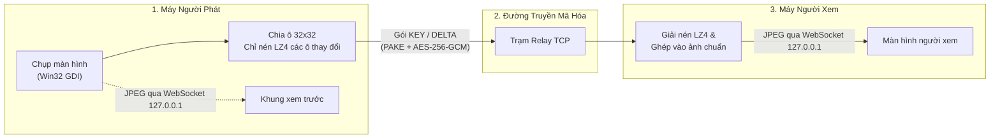

# Cẩm Nang Nhanh Dự Án CrocStream (`PROJECT_GUIDE.md`)

> **Tài liệu cốt lõi dành cho thành viên nhóm & bảo vệ đồ án (đọc trong 3–5 phút).** Chỉ cần đọc file này là bạn nắm trọn bài toán, cách hoạt động, điểm mới so với dự án gốc và câu trả lời khi thuyết trình.

---

## A. Tổng quan trong 1 phút

### 1. Dự án giải quyết vấn đề gì?
* **Hạn chế của `schollz/croc` gốc:** `croc` là công cụ dòng lệnh (CLI) giúp 2 máy tính gửi file cho nhau qua một mã mời ngắn. Tuy nhiên, `croc` **chỉ gửi được file tĩnh hoặc cửa sổ lệnh SSH** (cần biết trước kích thước file, gửi xong là ngắt) và không có giao diện đồ họa để xem màn hình trực tiếp.
* **Bài toán băng thông màn hình:** Một ảnh màn hình HD (`1280×720`) nặng tới **3,68 MB**. Nếu gửi thô 24 hình/giây sẽ tốn ~88 MB/giây, trong khi màn hình làm việc (gõ code, đọc tài liệu, chiếu slide) phần lớn diện tích đứng yên.
* **Giải pháp của CrocStream:**
  1. Tách cơ chế kết nối và mật mã của `croc` thành một **đường truyền hai chiều liên tục, có xác thực mật khẩu PAKE và mã hóa đầu cuối AES-256-GCM**.
  2. Xây dựng thuật toán nén **Tile-Delta**: chia màn hình thành các ô vuông `32×32` pixel, **chỉ nén không mất dữ liệu (LZ4) và gửi đi những ô có màu sắc thay đổi**, giúp tiết kiệm **85% – 95% băng thông** khi làm việc thông thường và hiển thị bảng số đo thực tế ngay trên màn hình.

### 2. Ví dụ thực tế dễ hình dung
**Minh** muốn chia sẻ màn hình code cho **Lan** xem cùng:
1. Hai máy cùng trỏ vào một trạm chuyển tiếp (**Relay** – bật sẵn trên máy Minh hoặc trong mạng LAN).
2. Minh mở CrocStream → chọn **Chia sẻ màn hình** → bấm **Bắt đầu chia sẻ** → nhận mã mời dùng một lần (`cs1-...`) và gửi cho Lan.
3. Lan mở CrocStream → chọn **Tham gia bằng mã** → dán mã mời → bấm **Tham gia phiên**.
4. Hai máy tự động khớp khóa bảo mật (PAKE) và màn hình của Minh hiện lên cửa sổ của Lan. Khi Minh chỉ gõ vài chữ ở góc màn hình, phần mềm chỉ gửi đúng vài ô vuông `32×32` chứa chữ vừa gõ. Khi Minh bấm **Dừng chia sẻ**, kết nối đóng lại và mã mời cũ bị hủy ngay lập tức.

---

## B. Hệ thống hoạt động như thế nào?



Toàn bộ quá trình diễn ra qua **3 cơ chế chính**:
1. **Kết nối & Mã hóa đầu cuối (`internal/crocduplex`):**
   * Hai máy dùng mã mời `cs1-...` gặp nhau tại trạm Relay, chạy thuật toán **PAKE** để chứng minh cả hai có cùng mã mời mà **không bao giờ gửi mã mời dạng rõ qua mạng**, sau đó khóa toàn bộ dữ liệu bằng **AES-256-GCM** (trạm Relay ở giữa chỉ chuyển tiếp chứ không xem trộm được ảnh).
2. **Truyền ảnh gốc (`KEYFRAME`) và phần thay đổi (`DELTA`) (`internal/delta`):**
   * Bức ảnh đầu tiên luôn gửi đầy đủ (**`KEYFRAME`**).
   * Ở các khung hình sau, màn hình được chia thành lưới ô `32×32` (920 ô ở độ phân giải `1280×720`). Ô nào có độ lệch màu trung bình vượt ngưỡng lọc nhiễu (`tau = 4`) mới được đóng gói vào bản tin **`DELTA`** gửi đi.
   * Nếu diện tích thay đổi quá lớn (**> 65%** màn hình) hoặc sau mỗi chu kỳ **30 khung hình**, máy phát tự động gửi lại một ảnh đầy đủ (`KEYFRAME`).
3. **Tự phục hồi lỗi (`PLI`) & Hiển thị mượt trên giao diện (`internal/bridge`):**
   * Nếu máy người xem phát hiện gói tin bị lỗi hoặc mất thứ tự, nó giữ nguyên bức ảnh tốt cuối cùng trên màn hình, báo `Đang phục hồi ảnh` và gửi tín hiệu **`REQUEST_KEYFRAME` (PLI)** yêu cầu máy phát gửi lại ảnh gốc mới.
   * Để vẽ ảnh từ Go lên giao diện React ở tốc độ 24 FPS mà không bị giật lag, ứng dụng chuyển ảnh chuẩn sang định dạng **JPEG** trong RAM rồi truyền qua cổng **WebSocket nội bộ (`127.0.0.1`)** có mã token bảo vệ.

---

## C. Sơ đồ thư mục & Bảng tra cứu nhanh trong `app/`

```text
CrocStream/
├── app/                           # [PHẦN MỀM CHÍNH]
│   ├── main_windows.go            # Điểm khởi chạy tạo cửa sổ ứng dụng Windows (Wails v3)
│   ├── frontend/src/              # ---> GIAO DIỆN NGƯỜI DÙNG (React + TypeScript)
│   │   ├── main.tsx               #      Màn hình trang chủ (3 nút: Chia sẻ / Xem / Xem trước)
│   │   ├── stream.tsx             #      Màn hình Chia sẻ & Xem phiên, nhập Relay, Sao chép mã
│   │   ├── local-preview.tsx      #      Màn hình Xem trước trên máy này (không cần mạng)
│   │   ├── capture-settings.tsx   #      Chọn màn hình, độ phân giải (720p/360p) và FPS (15/24/30)
│   │   └── stream-metrics.tsx     #      Bảng số đo FPS, KiB/s, RTT và mục Chi tiết luồng
│   ├── internal/                  # ---> BỘ XỬ LÝ NGẦM BÊN DƯỚI - BACKEND (Go)
│   │   ├── capture/               #      Chụp màn hình Windows bằng Win32 GDI
│   │   ├── frame/                 #      Chuẩn hóa màu sắc ảnh chụp về chuẩn RGBA
│   │   ├── delta/                 #      Chia ô 32x32, lọc ô thay đổi và nén không mất dữ liệu LZ4
│   │   ├── protocol/              #      Đóng/mở gói tin mạng (Header 18 byte, CONFIG 11 byte)
│   │   ├── crocduplex/            #      Sinh mã mời cs1-, xác thực PAKE và mã hóa AES-256-GCM
│   │   ├── transport/             #      Cầu nối giữa bộ điều phối phiên và crocduplex
│   │   ├── session/               #      Điều phối vòng đời phiên Chia sẻ / Xem & tự phục hồi
│   │   ├── preview/               #      Điều phối chế độ Xem trước tại máy
│   │   ├── bridge/                #      WebSocket 127.0.0.1 đẩy ảnh JPEG lên giao diện React
│   │   ├── latest/                #      Hàng đợi chỉ giữ 1 ảnh mới nhất (chống trễ hình khi nghẽn)
│   │   ├── telemetry/             #      Tính FPS, tốc độ KiB/s, % tiết kiệm băng thông trong 1 giây
│   │   └── desktop/               #      Gắn kết các hàm Go để giao diện React gọi xuống
│   └── cmd/demo-relay/            # Mã nguồn chương trình trạm chuyển tiếp (crocstream-relay.exe)
├── packaging/                     # Đóng gói bản Portable ZIP, bật relay (Start-DemoRelay.ps1) & DEMO.md
├── scripts/                       # Công cụ kiểm thử (verify.ps1), dọn file tạm (clean.ps1), cài môi trường
├── docs/                          # Hồ sơ thiết kế kỹ thuật (specs/) & lưu trữ nghiệm thu (archive-gates/)
└── croc/                          # Thư viện schollz/croc gốc giữ nguyên 100% làm đối chứng
```

---

## D. So sánh: Nhóm đã làm thêm gì so với `schollz/croc` gốc?

Mã nguồn `croc/` gốc được giữ nguyên 100% (chỉ tái sử dụng 3 gói cơ bản: tạo từ khóa `codephrase`, phòng chờ `tcp` và hàm mã hóa `crypt`). Toàn bộ phần mềm trong `app/` là do nhóm phát triển mới:

| Tiêu chí | Bản gốc (`schollz/croc`) | Dự án của nhóm (`CrocStream`) |
| --- | --- | --- |
| **Tính năng** | Chỉ truyền file tĩnh hoặc chia sẻ cửa sổ dòng lệnh SSH. | Truyền hình ảnh màn hình trực tiếp 1-1 (`1280×720` / `640×360` @ `15/24/30` FPS) và xem trước tại máy. |
| **Giao diện** | Gõ lệnh trên màn hình đen (CLI). | Ứng dụng Desktop Windows có giao diện đồ họa trực quan (Wails v3 + React), khung xem 16:9. |
| **Kênh truyền** | Gắn chặt với kích thước file, gửi hết file là đóng. | Luồng byte hai chiều liên tục (`crocduplex`), tách khóa mã hóa riêng cho chiều gửi/nhận, gửi được tín hiệu điều khiển ngược. |
| **Thuật toán nén** | Đọc/ghi nguyên khối dữ liệu file từ ổ cứng. | Chia lưới ô vuông `32×32`, chỉ nén LZ4 những ô thay đổi (`Tile-Delta`), tự động gửi lại ảnh gốc khi lỗi (`PLI`). |
| **Kết nối Relay** | Ngầm dùng máy chủ nước ngoài `croc.schollz.com:9009` với mật khẩu cố định `pass123`. | Chủ động chọn trạm Relay riêng (chạy ngay trên máy hoặc mạng LAN) với mật khẩu tự đặt an toàn. |
| **Đo lường** | Chỉ có thanh phần trăm tải file. | Bảng đo thời gian thực: FPS, băng thông thực tế so với nén toàn ảnh (`KiB/s`), `%` tiết kiệm và độ trễ `RTT`. |

---

## E. Kịch bản Demo 5 phút & Câu trả lời nhanh khi Bảo vệ

### 1. Các bước bấm Demo trực tiếp trên lớp
1. **Bật trạm Relay (30 giây):** Mở PowerShell chạy `.\packaging\Start-DemoRelay.ps1` (hoặc trong thư mục giải nén ZIP), đặt một mật khẩu từ 12 ký tự (ví dụ `crocstream-demo-2026`).
2. **Kết nối 2 cửa sổ `crocstream.exe` (2 phút):**
   * **Cửa sổ 1 (Người phát):** Chọn **Chia sẻ màn hình** → nhập relay `127.0.0.1:9009` và mật khẩu → bấm **Bắt đầu chia sẻ** → bấm **Sao chép mã**.
   * **Cửa sổ 2 (Người xem):** Chọn **Tham gia bằng mã** → nhập cùng địa chỉ và mật khẩu relay → dán mã vào **Mã phiên** → bấm **Tham gia phiên**.
3. **Chỉ điểm ăn tiền trên bảng số đo (1 phút):**
   * Bấm mở mục **Chi tiết luồng** ở cửa sổ Người phát: Khi màn hình đứng yên hoặc chỉ gõ chữ nhẹ, chỉ cho giảng viên thấy **`Tốc độ video (KiB/s)`** nhỏ hơn rất nhiều so với **`Nén toàn ảnh (KiB/s)`** và **`Tiết kiệm so với toàn ảnh`** đạt **~85% – 95%**.
   * Khi kéo/cuộn nhanh một cửa sổ lớn, băng thông tự tăng lên trung thực; khi bấm **Dừng chia sẻ**, cả hai bên xóa sạch màn hình và thu hồi mã mời ngay lập tức.

### 2. Năm câu hỏi giảng viên hay hỏi nhất (Trả lời ngắn gọn)

* **Câu 1: Tại sao truyền qua mạng dùng nén LZ4 mà khi vẽ lên giao diện lại dùng JPEG?**
  * *Trả lời:* Trên mạng bắt buộc dùng **nén không mất dữ liệu (LZ4)** vì các ô `DELTA` được ghép đè liên tiếp lên ảnh cũ; nếu dùng nén có mất dữ liệu như JPEG trên mạng thì vết nhòe sẽ cộng dồn làm hỏng chữ trên màn hình. Còn ở bước cuối cùng trong máy, chuyển ảnh chuẩn sang **JPEG** để trình duyệt giải mã bằng phần cứng giúp vẽ lên màn hình cực nhanh mà không làm lệch ảnh gốc.
* **Câu 2: Nếu có lọc nhiễu (`tau = 4`), vùng màn hình đổi màu từ từ có bị lệch giữa hai máy không?**
  * *Trả lời:* Không bao giờ bị lệch cộng dồn. Vì máy phát luôn so sánh ảnh mới chụp với **bức ảnh chuẩn đã thực sự gửi đi** (chứ không so với ảnh chụp trước đó). Các thay đổi nhỏ sẽ tích lũy dần đến khi vượt ngưỡng `4` thì ô đó sẽ được gửi đi, đảm bảo hai máy luôn khớp nhau từng byte.
* **Câu 3: Khi mạng bị chậm hơn tốc độ chụp màn hình thì xử lý thế nào để không bị tràn RAM hay vỡ hình?**
  * *Trả lời:* Hệ thống chỉ bỏ bớt ảnh chụp cũ **trước khi đưa vào bộ nén** (nhờ hàng đợi `latest` chỉ giữ 1 ảnh mới nhất). Một khi ảnh đã được nén thành gói `DELTA` thì luôn được gửi tuần tự, tuyệt đối không bỏ ngang gói `DELTA` ở giữa để tránh ghép sai ảnh phía sau.
* **Câu 4: Tại sao `croc` gốc không cần nhập Relay mà `CrocStream` lại cần nhập?**
  * *Trả lời:* `croc` gốc thực ra vẫn dùng Relay nhưng tác giả cài ngầm máy chủ miễn phí ở nước ngoài (`croc.schollz.com:9009`, mật khẩu `pass123`). CrocStream truyền hình ảnh liên tục nên tách ra cho người dùng tự chạy Relay ngay trên máy hoặc trong mạng LAN để tốc độ nhanh, không bị trễ mạng quốc tế và không làm quá tải máy chủ miễn phí của tác giả gốc.
* **Câu 5: Dự án có lưu lại hình ảnh hay mật khẩu không? Đã kiểm thử độ bền chưa?**
  * *Trả lời:* Toàn bộ ảnh và mật khẩu chỉ xử lý trong RAM, tuyệt đối không ghi xuống ổ cứng và bị xóa sạch ngay khi bấm Dừng. Dự án có bộ test tự động toàn diện (`verify.ps1 -Race`) và đã vượt qua bài test chạy liên tục **600 giây (10 phút)** ở `1280×720 @ 24 FPS` không rò rỉ bộ nhớ.
